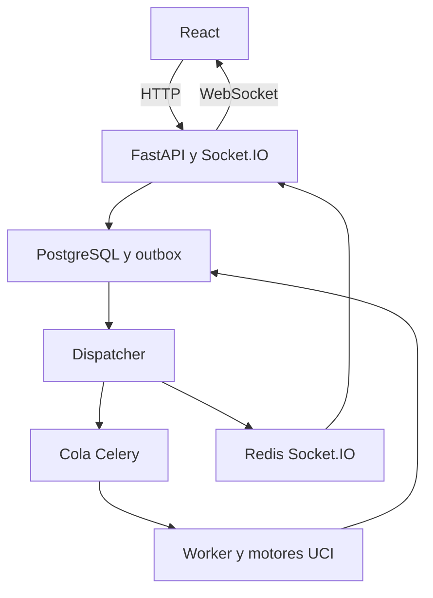

# ChessInsight — Análisis profundo asíncrono de posiciones

> **Supersedido para planificación:** ver [spec_analisis_profundo_unificado.md](./spec_analisis_profundo_unificado.md) (capacidad A). Este archivo se conserva como referencia histórica detallada.

Estado: especificación implementable y arquitectura candidata. Fecha: 2026-10-18.

## 1. Objetivo e instrucciones para Cursor

Implementar un módulo que permita solicitar análisis profundo de UNA posición desde el tablero, continuar usando la aplicación y recibir una notificación al terminar. Debe soportar un perfil general y otro orientado a sacrificios cuya compensación depende del ataque: si el defensor neutraliza las amenazas y conserva suficiente ventaja material, puede ganar; si no resiste, pierde. También se deben contemplar tablas y recuperación de material.

Antes de modificar código, inspeccionar la arquitectura real, autenticación, modelos de partidas/posiciones, integración UCI, workers y notificaciones. Reutilizar componentes existentes. Los nombres de archivos y clases de esta especificación son candidatos, no afirmaciones sobre el repositorio. No migrar el framework ni reemplazar el análisis liviano actual. Implementar mediante migraciones y feature flags.

No exigir LLM ni generación automática de explicaciones estratégicas para el MVP. Los motores aportan evaluaciones y variantes; no producen por sí solos una explicación causal fiable.

## 2. Alcance

Incluido:
- Botón «Análisis profundo» en la posición seleccionada.
- Perfiles `general` y `sacrifice_attack`.
- Snapshot inmutable de posición, historial conocido y candidata opcional.
- Cola persistente, worker separado, límites de recursos, cancelación y recuperación.
- Stockfish obligatorio; contraste con Lc0 opcional según capacidad del servidor.
- Estado y resultados persistidos en PostgreSQL.
- Eventos mediante python-socketio sobre WebSocket y recuperación mediante HTTP.
- Notificación interna persistente, historial de trabajos y variantes reproducibles.

Excluido: analizar automáticamente toda la partida, Web Push/email, modificar motores, entrenar modelos, asegurar demostraciones matemáticas de victoria, etiquetar automáticamente «brillante» y cambiar las evaluaciones originales de la partida.

## 3. Experiencia de usuario

1. Usuario selecciona una posición y pulsa «Análisis profundo».
2. Panel compacto: perfil, presupuesto permitido y contraste Lc0 si está disponible. Por defecto: general, hasta 300 segundos de ejecución; la espera en cola se muestra aparte.
3. En perfil sacrificio puede marcar una candidata legal. La UI distingue:
   - `decision`: evalúa la decisión desde la posición ANTERIOR al sacrificio.
   - `position_only`: analiza la posición actual, por ejemplo después de aceptar. No concluye que el sacrificio original era la mejor decisión.
4. Al enviar, recibe `job_id`, estado y snapshot asociado. El tablero continúa disponible.
5. Mostrar fase y tiempo transcurrido; no porcentaje artificial ni plazo garantizado de cola.
6. Puede cancelar. Cerrar pestaña no cancela.
7. Al finalizar, badge/toast y notificación persistente «Análisis profundo finalizado». Abrir devuelve al snapshot exacto.
8. Panel de resultado: evaluación, alternativas, mejor defensa encontrada, variantes, límites de evidencia y trazabilidad. Si la búsqueda no resolvió la compensación, mostrarlo expresamente.

El perfil general no requiere etiquetar ataque ni sacrificio. El resultado no sobrescribe automáticamente la anotación previa ni la revisión del instructor.

## 4. Arquitectura candidata

| Capa | Tecnología | Responsabilidad |
|---|---|---|
| UI | React + socket.io-client | Solicitudes HTTP, tablero, progreso y avisos |
| API | FastAPI + SQLAlchemy | Autorización, contratos, persistencia y consulta |
| Tiempo real | python-socketio AsyncServer + ASGIApp | Conexiones autenticadas y rooms privadas |
| Base | PostgreSQL existente | Estado autoritativo, snapshots, resultados, notificaciones, outbox |
| Cola de trabajo | Celery + Redis broker | Entrega de tareas a workers |
| Worker CPU | Proceso/contenedor independiente | Orquestación y Stockfish por UCI |
| Worker GPU opcional | Cola/recurso separado | Contraste Lc0 si hay hardware y red disponibles |
| Distribución de eventos | Redis + Socket.IO RedisManager | Transporte de eventos entre procesos y réplicas |
| Dispatcher | Proceso pequeño del módulo | Publicar outbox y reconciliar trabajos pendientes |

Separar namespaces/canales del broker Celery y del manager de Socket.IO. Pueden compartir instancia Redis inicialmente; nunca confundir Redis Pub/Sub con una cola durable de trabajos.



FastAPI BackgroundTasks no debe ejecutar el análisis ni ser el único mecanismo de despacho. No mantener motores dentro de handlers Socket.IO. Celery result backend no reemplaza el modelo de resultados de dominio.

## 5. Consistencia y ciclo de vida

Estados: `queued`, `running`, `cancel_requested`, `completed`, `cancelled`, `failed`.
Fases independientes: `baseline`, `candidate`, `defenses`, `deepening`, `crosscheck`, `finalizing`.

Transiciones permitidas:
- queued → running / cancelled / failed.
- running → cancel_requested / completed / failed.
- cancel_requested → cancelled / failed.
- Estados terminales no vuelven a running. Una nueva ejecución explícita crea otro trabajo.

Crear job y evento de outbox `job.dispatch_requested` en la misma transacción. El dispatcher publica la tarea después del commit y marca el envío. Si se cae entre publicar y marcar, puede haber duplicados: el worker debe ser idempotente.

El worker reclama el job mediante actualización atómica y lease con `attempt_id`, `lease_expires_at` y heartbeat. Solo el intento vigente puede actualizar fases y finalizar. No mantener una transacción abierta durante el cálculo. Un supervisor detecta leases vencidos y reencola dentro del máximo de reintentos; invalida el intento anterior. Toda escritura debe verificar el token vigente para impedir que un worker viejo sobrescriba el resultado.

Guardar resultado, estado terminal, notificación y evento terminal de outbox en una única transacción. Publicar después del commit. Si Redis no está disponible, el resultado continúa consultable y el dispatcher reintenta el aviso. Entrega de eventos puede repetirse: deduplicar por `event_id` y `state_version`.

Cancelación idempotente. Para queued, cancelar inmediatamente. Para running, marcar cancel_requested y comprobar bandera durante la búsqueda (intervalo objetivo ≤1 s). Enviar UCI stop, luego quit; terminar el grupo de procesos si no responde dentro de la gracia. Resolver carrera cancelación/finalización con bloqueo breve o compare-and-swap: el primer cambio confirmado determina el resultado.

## 6. Entrada ajedrecística y reproducibilidad

Validar FEN, turno, posición admisible, legalidad de candidata y secuencia de movimientos. Limitar longitud de entrada. Soportar ajedrez estándar en MVP; rechazar variantes no implementadas.

Guardar `initial_fen` + lista de movimientos UCI hasta la posición y `root_fen` derivada. Cuando solo existe FEN, conservar el reloj de medio movimiento y marcar `history_complete=false`; las repeticiones previas pueden ser desconocidas.

No reconstruir el historial a partir del FEN. Para decisiones, `candidate_move_uci` se aplica sobre root_fen anterior al sacrificio. Para posiciones aisladas no inventar movimiento anterior ni bando sacrificante; el perfil requiere `perspective_color` explícito.

Snapshots, parámetros efectivos y versiones son inmutables. Una nueva configuración genera otra ejecución. No compartir caché entre usuarios en MVP.

## 7. Perfiles y presupuesto global

Valores iniciales propuestos, calibrables; no son garantías de calidad. El límite es GLOBAL por job, no 300 segundos por rama. El reloj de ejecución empieza al reclamarlo, excluye cola e incluye arranque, búsquedas y persistencia final. Reservar 10 segundos para limpieza/finalización. No se ejecuta una etapa sin presupuesto disponible.

```yaml
profile_version: 1
max_execution_seconds: 300
finalization_reserve_seconds: 10
max_attempts: 2
stockfish:
  threads: 2
  hash_mb: 256
  limit_strength: false
  show_wdl: true
  exploration_multipv: 4
  defense_multipv: 5
  max_critical_defenses: 3
  initial_search_seconds: 10
  candidate_search_seconds: 30
  defense_search_seconds: 20
  deepening_slice_seconds: 30
lc0:
  enabled: false
  optional_budget_seconds: 60
  unavailable_policy: skip_with_warning
resources:
  max_active_jobs_per_user: 1
  max_queued_jobs_per_user: 3
  worker_engine_slots: 1
```

Lc0 toma presupuesto del total; no agrega 60 segundos al máximo. Hasta 180 segundos en una rama solo si queda presupuesto y el scheduler lo permite. Registrar `allocated_ms` y `consumed_ms` por etapa.

Concurrencia inicial baja. Dimensionar slots × threads según CPU disponible y slots × hash más memoria real de motores, API y base. Cada proceso UCI pertenece a una sola búsqueda a la vez. Lc0 requiere límite independiente de memoria/GPU. No comparar profundidad o nodos entre ambos motores como esfuerzo equivalente.

## 8. Algoritmo de análisis

### 8.1 General

1. Analizar raíz con MultiPV 4 y presupuesto corto.
2. Guardar candidatas, scores, WDL cuando exista, PV y métricas.
3. Profundizar individualmente las candidatas relevantes, sin restringir respuestas posteriores.
4. Reanalizar posiciones críticas cuando cambie el orden de candidatas o la evaluación.
5. Contraste Lc0 opcional en raíz o posición crítica seleccionada.
6. Entregar resultado técnico con evidencia, incluso cuando no hay conclusión estratégica.

### 8.2 Sacrificio: ataque contra material

1. Si hay candidata, compararla con la mejor alternativa desde la misma raíz; estudiarla aunque no esté en el top MultiPV.
2. Usar `searchmoves`/`root_moves` para limitar exclusivamente el primer movimiento candidato; no forzar una secuencia del rival.
3. Tras candidata, explorar respuestas con MultiPV 5. Incluir aceptación inmediata identificable aunque no entre al top, y otras respuestas legales señaladas por usuario/instructor. La aceptación puede ser diferida: no asumir que todo sacrificio consiste en una captura inmediata.
4. Seleccionar hasta tres defensas críticas por evaluación favorable al defensor, variación de evaluación o mecanismo distinto identificado. No afirmar que se analizaron todas las defensas porque se usó MultiPV.
5. Profundizar cada defensa en búsqueda independiente con MultiPV 1. Dentro de esa rama, el atacante también juega su mejor continuación.
6. Evaluar hojas críticas para comprobar si persisten amenazas, aparece mate, recuperación de material, perpetuo, simplificación o ventaja material estable. No usar un simple balance material para declarar que el ataque terminó.
7. Repetir con presupuesto creciente donde cambie la conclusión o la compensación siga incierta.
8. Contrastar con Lc0 cuando esté disponible. Desacuerdo relevante se conserva como evidencia pendiente, no se resuelve promediando scores.

No existe un comando UCI «calcular hasta resolver el ataque». La selección de posiciones y la condición de parada son heurísticas del módulo. El MVP debe ser conservador: si no puede establecer la resolución de la compensación, devuelve `unresolved` y permite revisión humana.

### 8.3 Evaluación y clasificación

Normalizar scores a `perspective_color`, independientemente del turno en cada posición. Mantener score de mate separado de centipeones; no convertir mate en un número artificial para restarlo. Conservar WDL con motor/configuración de origen; no presentarlo como probabilidad de victoria del usuario ni promediarlo entre motores.

Veredicto estratégico para sacrifice_attack:
- `supported_by_analysis`: evidencia estable favorable al sacrificante bajo las defensas examinadas y mecanismo respaldado; nunca texto «demostrado» por simple coincidencia de motores.
- `refuted_by_line`: una defensa examinada lleva de forma estable a posición favorable al defensor; mostrar variante y límites de evidencia.
- `draw_or_material_recovery`: el análisis respalda un desenlace intermedio, sin forzar la dicotomía ganar/perder.
- `unresolved`: presupuesto insuficiente, evaluación inestable, desacuerdo relevante o compensación sin resolver.
- `not_applicable`: perfil general o entrada sin contexto suficiente para valorar el sacrificio como decisión.

Separar `technical_stability` de `compensation_resolution`. Regla técnica inicial configurable: dos búsquedas crecientes desde la MISMA raíz y motor con cambio absoluto ≤50 cp, misma categoría de score y sin inversión relevante de la conclusión. Esto mide estabilidad; no prueba corrección. Para mate exigir signo consistente y conservar distancias observadas, sin aplicar umbral cp.

Si no hay detector fiable del mecanismo, dejar compensation_resolution=unknown y veredicto estratégico unresolved, aunque el score sea estable. Mostrar evaluación técnica sin ocultarla. No inventar causalidad usando únicamente material o seguridad del rey.

Guardar comparación con mejor alternativa. Un sacrificio puede mantener ventaja y ser inferior a otra jugada. Estas dos afirmaciones deben coexistir.

## 9. Modelo persistente candidato

| Entidad | Campos mínimos |
|---|---|
| deep_analysis_jobs | id UUID, user_id, game_id/position_id opcionales, snapshot JSONB, profile, scope, effective_config JSONB, config_version, dedup_key, status, phase, state_version, timestamps, deadline, attempt_id, attempt_count, lease_expires_at, heartbeat_at, cancel_requested_at, error_code |
| deep_analysis_runs | id, job_id, attempt_id, stage, root_fen/history, restricted_root_moves, engine/version/network_hash, limits, elapsed_ms, nodes, depth/seldepth, score_type/value, perspective, WDL, PV UCI, bounds, warnings |
| deep_analysis_results | id, job_id único, verdict, technical_stability, compensation_resolution, best_defense_run_id, alternatives, evidence_run_ids, limitations, completion_reason |
| notifications | id, user_id, job_id, type, created_at, read_at; clave única job/type |
| outbox_events | event_id, job_id, kind, state_version, payload, created_at, published_at, retry_count, next_attempt_at |

Índices por user/status/created_at, outbox pendiente, leases vencidos. Unique(user_id, idempotency_key) y restricción para dedup activo. Revisiones humanas deben guardarse aparte con autor/fecha y referencias a evidencia, sin modificar el resultado original del motor.

`completion_reason`: stable, budget_exhausted, terminal_position, optional_engine_unavailable. Agotar presupuesto de búsqueda con resultado parcial utilizable produce completed + unresolved cuando corresponda. Crash del motor obligatorio sin evidencia utilizable produce failed. Un fallo de Lc0 opcional no invalida Stockfish.

## 10. Contratos HTTP

Todos autenticados y limitados al propietario.

| Método y ruta | Función |
|---|---|
| POST /api/deep-analysis/jobs | Crear; 202 con job_id, status y enlaces |
| GET /api/deep-analysis/jobs/{id} | Snapshot, estado y versión |
| GET /api/deep-analysis/jobs | Lista paginada, filtro de estado/fecha |
| POST /api/deep-analysis/jobs/{id}/cancel | Cancelación idempotente |
| GET /api/deep-analysis/jobs/{id}/result | Resultado o 409 si todavía no existe |
| GET /api/notifications | Recuperar avisos persistentes |
| POST /api/notifications/{id}/read | Marcar leído |

Ejemplo POST, scope decision:

```json
{
  "profile": "sacrifice_attack",
  "scope": "decision",
  "position": {
    "initial_fen": "<FEN inicial válida>",
    "moves_uci": [],
    "root_fen": "<misma FEN cuando no hay movimientos>",
    "history_complete": false
  },
  "candidate_move_uci": "<jugada legal desde root_fen>",
  "perspective_color": "black",
  "budget_seconds": 300,
  "crosscheck_lc0": false
}
```

Enviar `Idempotency-Key` UUID. Misma clave y mismo payload devuelve el mismo job; misma clave con payload diferente devuelve 409. Petición equivalente activa con otra clave devuelve job existente y `reused=true`. Fingerprint incluye propietario, historial, candidata, perfil y configuración efectiva/versiones; FEN por sí sola no es suficiente. Recalcular explícitamente un resultado completado permite nuevo job. 422 para entrada inválida; 429 para cupo excedido. Nunca aceptar user_id, rutas de binarios ni opciones UCI arbitrarias del cliente.

## 11. Socket.IO

Path de transporte `/socket.io`; namespace `/analysis`. Son conceptos distintos. Autenticar handshake usando el mecanismo de sesión existente; para JWT usar `auth`, no query string. Validar expiración y revocación; al expirar, desconectar o requerir reconexión autenticada. Configurar orígenes permitidos explícitos y TLS.

Al conectar, servidor añade sid a room `user:{authenticated_user_id}` dentro de /analysis. No aceptar desde cliente el user_id o room arbitrario. Todas las pestañas/dispositivos del usuario pueden recibir avisos. Revalidar permisos HTTP para leer resultados.

Eventos: analysis.queued, analysis.started, analysis.phase_changed, analysis.completed, analysis.cancelled, analysis.failed. Limitar eventos transitorios a uno por segundo por job; nunca emitir cada línea UCI.

```json
{
  "schema_version": 1,
  "event_id": "<uuid>",
  "type": "analysis.completed",
  "job_id": "<uuid>",
  "state_version": 9,
  "occurred_at": "2026-10-18T20:30:00Z",
  "data": {
    "status": "completed",
    "result_id": "<uuid>",
    "notification_id": "<uuid>",
    "completion_reason": "budget_exhausted"
  }
}
```

Evento transporta metadatos pequeños, no el resultado completo. UI obtiene resultado por HTTP. Ignorar eventos repetidos o con state_version anterior. Suscribirse antes de solicitar snapshot HTTP y aplicar siempre la versión más nueva para resolver carreras de reconexión. En cada connect/reconnect refrescar trabajos y notificaciones, sin asumir replay automático de Socket.IO.

Si WebSocket falla, usar polling HTTP espaciado mientras haya trabajos activos (ejemplo 10 s con backoff). No depender del socket para completar trabajos. MVP puede configurar transporte WebSocket exclusivo; si se habilita long-polling Socket.IO al escalar, configurar afinidad de sesión según despliegue. Redis compartido no sustituye esa afinidad. Diferenciar polling HTTP propio de recuperación y long-polling del transporte Socket.IO.

Composición candidata: socketio.AsyncServer(async_mode='asgi', client_manager=AsyncRedisManager(...)); envolver FastAPI con ASGIApp. Publicador externo síncrono puede usar RedisManager(write_only=True), siempre mismo canal y namespace. Verificar integración de lifespan/startup/shutdown de FastAPI al envolver la app y probarla. No es necesario tener dos publicadores: centralizar emisión durable en dispatcher.

## 12. Fiabilidad, operación y seguridad

- Cola Celery dedicada a análisis; prefetch bajo (inicial 1). Configurar reentrega/reintentos según versión y broker; nunca asumir exactly-once.
- Outbox/reconciliador recupera queued no despachados y leases abandonados; tarea solo contiene job_id, no secretos ni PGN completo.
- Redis con persistencia adecuada para broker; PostgreSQL conserva intención y permite reconciliar pérdida de mensajes.
- Procesos UCI con rutas configuradas en servidor, argumentos estructurados sin shell, timeout y limpieza de hijos en cancelación, excepción y apagado.
- Límite duro externo mayor que deadline más gracia; supervisión del contenedor para no dejar motores huérfanos.
- Proxy con Upgrade WebSocket y timeouts compatibles con heartbeat; cierre ordenado durante despliegues.
- Registrar job_id, attempt_id, fase, recursos y motor; no tokens. Métricas: espera, ejecución, fallos, cancelaciones, profundidad alcanzada, desacuerdos y tasa de unresolved.
- No registrar afirmaciones de «victoria forzada» salvo evidencia apropiada y verificada; tablebases, cuando sean aplicables y disponibles, se identifican por separado.
- Retención configurable de trazas extensas. Resultados y avisos sobreviven a reinicios.

## 13. Pruebas y criterios de aceptación

1. Crear desde tablero devuelve 202 sin esperar cálculo y no bloquea navegación.
2. Cambiar posición mientras corre no altera snapshot ni resultado.
3. Cerrar/reabrir recupera job y aviso; no requiere socket original.
4. Un usuario no puede consultar, cancelar ni recibir eventos de otro.
5. Doble clic, reenvío de petición y entrega duplicada de tarea no duplican ejecución efectiva ni resultado terminal.
6. Reinicio API no interrumpe worker; caída worker invalida lease y recupera según política sin escrituras tardías.
7. Caída Redis después de guardar resultado no lo pierde: HTTP lo recupera y outbox reintenta aviso.
8. Cancelación durante UCI termina procesos y libera slot; probar carrera contra finalización.
9. Presupuesto total incluye todas las ramas y Lc0; nunca se multiplica accidentalmente por cantidad de variantes.
10. Alternancia de turnos no invierte el score normalizado. Mate, bounds y WDL se conservan correctamente.
11. Candidata fuera del top MultiPV se analiza; respuestas posteriores no quedan artificialmente restringidas.
12. Ausencia de historial muestra limitación de repetición. Variante ilegal/FEN incoherente se rechaza.
13. Resultado unresolved puede estar completed; no confundir incertidumbre ajedrecística con fallo técnico.
14. Lc0 ausente produce degradación visible y no falla análisis Stockfish.
15. Eventos duplicados/desordenados no regresan estado UI ni duplican notificaciones.
16. Todas las PV se reproducen legalmente desde su raíz. No exigir PV exacta idéntica entre ejecuciones de motor.
17. Fixtures ajedrecísticos: sacrificio con mate corto verificable, entrega claramente refutada, tablas/perpetuo, compensación posicional incierta. La imagen del reel no debe usarse como caso etiquetado ganador sin validación independiente.

Usar adaptadores de motor simulados para orquestación, presupuestos y errores; integración real limitada para UCI. Integración PostgreSQL/Redis para atomicidad, recuperación y permisos. Flujo E2E con reconexión y cancelación.

## 14. Entrega por etapas

1. Dominio, contratos, migración, feature flag, snapshots e idempotencia.
2. Cola/worker, leases, outbox y adaptador Stockfish con presupuesto global.
3. UI, HTTP de recuperación, Socket.IO y notificaciones persistentes.
4. Perfil sacrificio: candidata, defensas y análisis por ramas; resultados conservadores sin LLM.
5. Lc0 opcional, calibración de heurísticas y revisión del instructor.

Entregar código integrado, migración reversible donde sea viable, configuración de entorno documentada, servicios locales de desarrollo, pruebas de aceptación y guía operativa de reinicio/cancelación. Mantener python-socketio y socket.io-client en versiones compatibles fijadas en lockfiles. No agregar wrappers abandonados si la integración ASGI oficial es suficiente.

## 15. Fuentes técnicas

Las decisiones de producto, presupuestos, estados y contratos anteriores son propuestas para ChessInsight. Consultar estas fuentes para APIs y restricciones concretas de la versión instalada:

- python-socketio, servidor, ASGI, autenticación, rooms y despliegue: https://python-socketio.readthedocs.io/en/stable/server.html
- Managers Redis y emisión entre procesos: https://python-socketio.readthedocs.io/en/stable/api_manager.html
- Celery, tareas e idempotencia: https://docs.celeryq.dev/en/stable/userguide/tasks.html
- Stockfish, protocolo UCI: https://github.com/official-stockfish/Stockfish/wiki/UCI-%26-Commands
- Lc0, parámetros del motor: https://lczero.org/play/configuration/flags/
