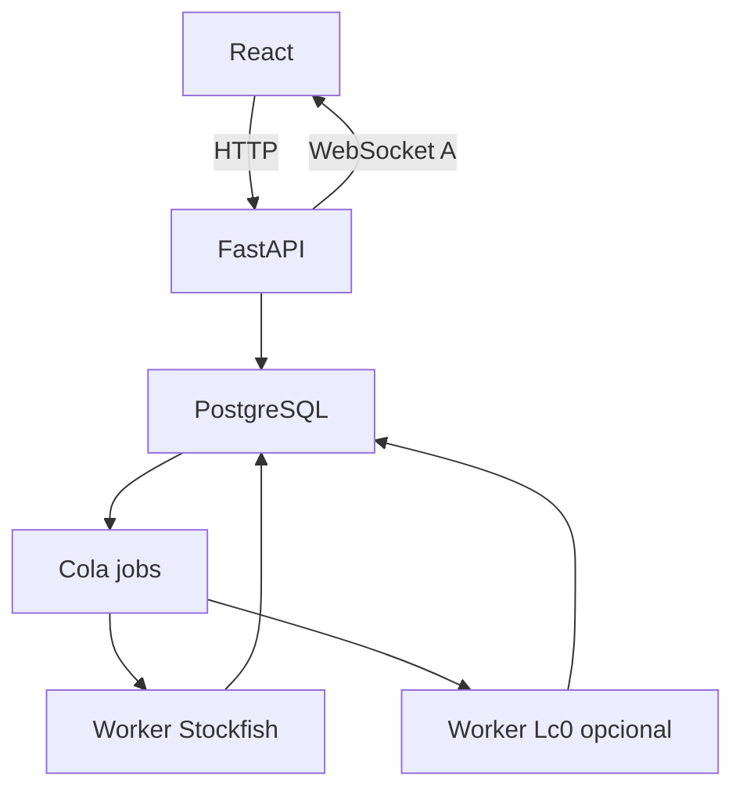

# ChessInsight — Análisis profundo en servidor (especificación unificada)

**Identificador:** CI-DEEP-UNIFIED  
**Estado:** especificación implementable · **Versión:** 2.0 · **Fecha:** 2026-10-19  
**Documento canónico único** para análisis profundo en servidor (no usar specs fuente separadas).  
**Arquitectura e implementación:** [roadmap/deep_analysis/index.md](./roadmap/deep_analysis/index.md) (no duplicar detalle técnico aquí).

## 0. Tres capacidades, una plataforma

| Capacidad | Alcance | Entrada | Perfil |
|---|---|---|---|
| **A — Posición** | Una posición desde el tablero; async; notificación al terminar | FEN + historial UCI, candidata opcional | `general`, `sacrifice_attack` |
| **B — Partida completa** | Toda la partida; errores; críticas; filtro «Partidas para revisar» | Partida(s) seleccionada(s) | `server_deep_v1` |
| **C — Contraste Lc0** | Segunda pasada solo en **posiciones críticas** ya obtenidas de B | `analysis_id` + críticas elegidas | `lc0_critical_v1` |

**Flujo pedagógico típico:** filtro de partidas → **B** (Stockfish canónico) → **C** opcional en críticas → **A** bajo demanda en una ply concreta (p. ej. sacrificio de dama).

**Compartido:** motores en worker; trabajos persistentes; no bloquear HTTP; resultados reproducibles; análisis liviano (WASM) sigue como preview — no reemplazarlo ni migrar umbrales salvo adaptación técnica. **Un** servicio de jobs/UCI/persistencia; tres puntos de entrada (API distintas, misma infra).

**Fuera de alcance global:** LLM; explicaciones estratégicas automáticas; Web Push/email; entrenar modelos; demostración matemática de victoria; etiqueta «brillante» automática; ejercicios auto-generados; Lc0 en toda la partida por defecto.

**Instrucciones para Cursor:** inspeccionar auth, module07/jobs, UCI, notificaciones. Reutilizar y extender; nombres aquí son candidatos. Feature flags y migraciones.

### 0.1 Arquitectura candidata (A, B, C)

| Capa | Tecnología | Responsabilidad |
|---|---|---|
| UI | React (+ socket.io-client en A) | Solicitudes, progreso, resultados |
| API | FastAPI + SQLAlchemy | Auth, contratos, persistencia |
| Tiempo real | python-socketio (A) | Rooms `user:{id}`, eventos de job |
| Base | PostgreSQL | Jobs, análisis, críticas, contrastes, outbox |
| Cola | Celery + Redis (o extensión jobs existentes) | Workers |
| Worker CPU/GPU | Procesos separados | Stockfish; Lc0 en cola/recurso GPU opcional |
| Dispatcher | Outbox + reconciliador | Publicar eventos; leases |



No ejecutar análisis completo en HTTP síncrono. No compartir un proceso UCI entre trabajos sin exclusión. **B** y **C** pueden usar polling; **A** usa Socket.IO + fallback HTTP.

### 0.2 Reglas comunes de evaluación

- Persistir scores tipados: `cp`, `mate`, `wdl`; perspectiva blanca en almacenamiento; convertir al jugador al mostrar.
- `loss_cp = max(0, best_before_cp - played_after_cp)` solo con scores comparables; mate con política explícita, no cp sintético.
- Búsqueda restringida (`searchmoves`) para verificar jugada realizada; registrar presupuestos distintos.
- Inestabilidad entre búsquedas → revisar, no truncar a cero silenciosamente.
- **No** promediar/restar cp entre Stockfish y Lc0; **no** comparar profundidad/nodos como calidad equivalente.
- WDL: registrar origen; no presentar como probabilidad empírica del Elo del usuario.
- Lc0 no reemplaza Stockfish; discrepancia ≠ «Lc0 tiene razón» ni «sacrificio correcto».

### 0.3 Ciclo de vida de jobs (común)

Estados: `queued`, `running`, `cancel_requested`, `completed`, `cancelled`, `failed`.  
Reclamo con `attempt_id`, lease, heartbeat; worker idempotente; cancelación UCI `stop`/`quit`.  
Job + outbox en misma transacción; dedup por huella de entrada + `Idempotency-Key` donde aplique.

---

## 1. Capacidad A — Análisis profundo de posición

### 1.1 Objetivo

Botón «Análisis profundo» en una posición; seguir usando la app; notificación al terminar. Perfil `sacrifice_attack`: compensación por ataque (defensor puede neutralizar y ganar material; tablas/recuperación). Motores dan evaluación y PV, no causalidad pedagógica automática.

### 1.2 Alcance

Incluido: snapshot inmutable; cola; Stockfish obligatorio; Lc0 opcional dentro del presupuesto del job; Socket.IO + HTTP; notificaciones persistentes.  
Excluido: partida completa (→ B); sobrescribir anotaciones sin revisión explícita.

### 1.3 UX

Panel: perfil, presupuesto (default 300 s **ejecución**, cola aparte), Lc0 si hay servidor.  
`sacrifice_attack`: `decision` (desde posición anterior al sacrificio) vs `position_only` (posición actual; no juzga la decisión original).  
Cancelar; cerrar pestaña no cancela. Resultado: alternativas, defensas, límites; `unresolved` si no resuelve compensación.

### 1.4 Fases y algoritmo

Fases: `baseline`, `candidate`, `defenses`, `deepening`, `crosscheck`, `finalizing`.

**General:** MultiPV raíz → profundizar candidatas → Lc0 opcional.  
**Sacrificio:** candidata vs mejor alternativa; `searchmoves` solo primer movimiento candidato; MultiPV defensas (aceptación inmediata o diferida); hasta 3 defensas críticas; profundizar ramas; veredictos: `supported_by_analysis`, `refuted_by_line`, `draw_or_material_recovery`, `unresolved`, `not_applicable`. Separar `technical_stability` y `compensation_resolution`.

### 1.5 Perfil A (presupuesto global)

```yaml
profile_version: 1
max_execution_seconds: 300
finalization_reserve_seconds: 10
stockfish:
  threads: 2
  hash_mb: 256
  exploration_multipv: 4
  defense_multipv: 5
  max_critical_defenses: 3
lc0:
  enabled: false
  optional_budget_seconds: 60  # dentro del total, no suma extra
resources:
  max_active_jobs_per_user: 1
  max_queued_jobs_per_user: 3
```

### 1.6 Persistencia A

`deep_analysis_jobs`, `deep_analysis_runs`, `deep_analysis_results`, `notifications`, `outbox_events`.  
Entrada: `initial_fen`, movimientos UCI, `history_complete`, `candidate_move_uci`, `perspective_color`.

### 1.7 API A

| Ruta | Función |
|---|---|
| POST /api/deep-analysis/jobs | 202 + job_id |
| GET /api/deep-analysis/jobs/{id} | Estado, snapshot |
| POST /api/deep-analysis/jobs/{id}/cancel | Idempotente |
| GET /api/deep-analysis/jobs/{id}/result | Resultado o 409 |
| GET/POST /api/notifications | Avisos persistentes |

Ejemplo POST (`sacrifice_attack`, `decision`):

```json
{
  "profile": "sacrifice_attack",
  "scope": "decision",
  "position": {
    "initial_fen": "<FEN>",
    "moves_uci": [],
    "root_fen": "<FEN>",
    "history_complete": false
  },
  "candidate_move_uci": "<uci legal>",
  "perspective_color": "black",
  "budget_seconds": 300,
  "crosscheck_lc0": false
}
```

### 1.8 Socket.IO A

Namespace `/analysis`; eventos `analysis.*` con metadatos; resultado completo por HTTP. Fallback polling ~10 s.

### 1.9 Aceptación A (resumen)

202 sin bloqueo; snapshot inmutable; permisos; idempotencia; leases; cancelación UCI; presupuesto global incluye Lc0; mate/cp; candidata fuera de MultiPV; `completed`+`unresolved`; fallo Lc0 no invalida Stockfish; PV legales.

---

## 2. Capacidad B — Análisis completo Stockfish (partida)

### 2.1 Objetivo

Analizar partida almacenada con Stockfish servidor: evaluar posiciones, comparar jugada vs mejor alternativa, detectar errores y **posiciones críticas** para revisión humana y para **C**. Alimentar filtro pedagógico. Trabajo fallido/incompleto no reemplaza análisis completo previo.

### 2.2 Flujo

1. Validar partida y reconstruir posiciones (historial, no solo FEN).  
2. Resolver perfil; dedup por huella.  
3. Crear job → 202.  
4. Recorrido con perfil base → pérdidas y eventos.  
5. Seleccionar críticas (reglas versionadas + manual).  
6. Profundizar críticas (MultiPV, verificación `searchmoves`).  
7. Recalcular clasificaciones afectadas e indicadores.  
8. Persistir; marcar análisis preferido solo si cobertura completa.

### 2.3 Perfil `server_deep_v1`

| Parámetro | Valor inicial |
|---|---|
| engine | Stockfish fijado |
| threads | 1 |
| hash_mb | 256 |
| base_time_ms | 2000 / posición |
| base_multipv | 1 |
| critical_time_ms | 5000 |
| critical_multipv | 3 |
| concurrencia jobs | 1 |

Registrar: binario, NNUE, UCI efectivo, profundidad/nodos alcanzados, versión clasificador.

### 2.4 Posiciones críticas (salida de B, entrada de C)

Motivos configurables: pérdida > umbral; cambio ventaja/igualdad/inferioridad; mate aparece/desaparece; oportunidad desapropechada; diferencia entre candidatas; selección manual.  
Registrar **todos** los motivos aplicables. Separar gravedad técnica, cambio de estado, interés pedagógico. No inferir psicología solo por cp.

Cada crítica: `decision_ply`, posición **before** (decisión), **after** (resultado jugada); evaluaciones y método de comparación.

### 2.5 Indicadores pedagógicos

Reglas «Partidas para revisar»: mistakes/blunders propios y rival, superioridad/inferioridad, ventaja desapropechada, recuperación, etc. Versión de reglas + id análisis fuente. No mezclar con liviano.

### 2.6 Persistencia B (propuesta)

| Entidad | Rol |
|---|---|
| AnalysisJob | user_id, game_id, profile_id, status, progress, lease, error |
| GameAnalysis | game_id, job_id, input_hash, engine_fingerprint, classifier_version, coverage |
| PositionAnalysis | ply, fen, score_type, score_cp, mate, wdl, best_move, PV, limits |
| AnalysisVariation | candidata rank, moves_uci, scores |
| MoveAssessment | played vs best, loss_cp, classification, unstable |
| CriticalPosition | decision_ply, before/after ids, reasons[], severity, manual |

No sobrescribir silenciosamente otro perfil/motor.

### 2.7 API B (propuesta; adaptar a module07)

```text
POST /api/games/{game_id}/analysis-jobs     # body: profile_id, force
GET  /api/analysis-jobs/{job_id}
POST /api/analysis-jobs/{job_id}/cancel
GET  /api/games/{game_id}/analyses
GET  /api/analyses/{analysis_id}
GET  /api/analyses/{analysis_id}/positions
GET  /api/analyses/{analysis_id}/critical-positions
```

UI: «Analizar en servidor», progreso por unidades (no ETA falsa), cancelación, distinguir liviano vs servidor persistido.

### 2.8 Aceptación B (resumen)

Job async; perspectiva y mate/cp; loss desde jugador; críticas versionadas; dedup; cancelación; fallo consultable; parcial con cobertura; permisos; no sobrescribir procedencia distinta.

---

## 3. Capacidad C — Contraste Lc0 en posiciones críticas

**Dependencia:** análisis **B** persistido (`GameAnalysis` + `CriticalPosition`). Stockfish permanece canónico para clasificación y críticas.

### 3.1 Objetivo

Segunda pasada Lc0 solo en críticas seleccionadas: evaluación independiente, comparar candidatas, etiquetas de acuerdo/discrepancia, evidencia para revisión humana. No sustituye automáticamente etiquetas SF.

### 3.2 Alcance

Incluido: selección manual o automática post-B; async; hasta N críticas por job; candidatas (SF best, jugada realizada, Lc0 best); contraste versionado; una ronda de reanálisis Lc0 ante discrepancia relevante.  
Excluido: Lc0 en cada ply; LLM; atribuir planes/intenciones; declarar Lc0 «más estratégico»; corregir alumno sin humano.

### 3.3 Selección y raíces

Entrada: `analysis_id`, `critical_position_ids[]`, `include_after` (analizar posición resultante cuando aplique).  
**before** = raíz para comparar decisiones; **after** = continuidad post-jugada; no tratarlas como la misma FEN raíz. Deduplicar por contexto (repeticiones). Máximo configurable de posiciones por job.

### 3.4 Perfil `lc0_critical_v1`

| Parámetro | Valor inicial |
|---|---|
| base_time_ms | 5000 / búsqueda |
| max_candidates | 3 |
| disagreement_time_ms | 15000 (revisión) |
| max_reanalysis_rounds | 1 |

Registrar: ejecutable, hash red, backend/dispositivo, UCI negociado, capacidades (MultiPV, WDL, searchmoves) — degradación explícita si falta.

### 3.5 Candidatas y comparabilidad

Conjunto inicial: mejor SF, jugada realizada, mejor Lc0; dedup. Comparar dentro del **mismo motor** con presupuestos documentados. Si se usa posición hija, registrar método; no presentar como idéntico a raíz.

### 3.6 Contraste determinista (política versionada)

Etiquetas: `agreement`, `alternative_preference`, `evaluation_disagreement`, `unstable`, `insufficient_evidence`.  
No implicar automáticamente: «SF erró», «Lc0 entiende el plan», «sacrificio correcto».  
Reanálisis: una ronda; conservar inicial y revisado; discrepancia persistente visible para humano.

### 3.7 Persistencia C (propuesta)

| Entidad | Rol |
|---|---|
| EngineRun | job_id, source_analysis_id, engine, network_hash, backend, profile, config |
| EnginePositionResult | critical_id, role before/after, fen, search_kind, scores, PV, reanalysis_round |
| EngineComparison | sf_result_id, lc0_result_id, policy_version, label, reasons, limitations |

Contrastes inmutables; nuevo run no altera retrospectivamente comparaciones pasadas.

### 3.8 API C (propuesta)

```text
POST /api/analyses/{analysis_id}/lc0-jobs
  # body: profile_id, critical_position_ids, include_after, force
GET  /api/analysis-jobs/{job_id}
POST /api/analysis-jobs/{job_id}/cancel
GET  /api/analyses/{analysis_id}/engine-comparisons
GET  /api/engine-comparisons/{comparison_id}
```

UI en críticas: «Contrastar con Lc0»; dos columnas SF vs Lc0; sin barra mezclada de scores.

### 3.9 Aceptación C (resumen)

Solo críticas elegidas; before/after correctos; SF intacto; capacidades UCI validadas; no promediar motores; política versionada; una ronda reanálisis; fallo Lc0 no invalida B; dedup; permisos; GPU/ausencia con error claro.

### 3.10 Relación con A

Lc0 en **A** es contraste **dentro de un job de posición** (presupuesto compartido, sacrificio). **C** es contraste **batch sobre críticas de partida**. Reutilizar adaptador Lc0 y normalización; no duplicar colas si la inspección lo permite.

---

## 4. Roadmap integrado

| Fase | Entrega |
|---|---|
| 1 | Infra jobs compartida (module07/Celery), leases, outbox, migraciones |
| 2 | **B** `server_deep_v1` + críticas + indicadores + UI polling |
| 3 | **C** adaptador Lc0 + hook post-críticas + comparador + UI contraste |
| 4 | **A** jobs posición + Socket.IO + `general` |
| 5 | **A** `sacrifice_attack` + calibración |
| 6 | Unificación caches, métricas operativas, HITL en divergencias |

Orden intercambiable: **A** antes de **B** si el producto prioriza sacrificios puntuales.

---

## 5. Fuentes técnicas

**Procedencia del documento:** v2.0 integra y reemplaza los specs fuente `spec_analisis_profundo_asincrono.md` (A), `spec_análisis_profundo.md` (B) y el diseño Oct-2025 de contraste Lc0 en críticas (C). Esos archivos ya no se mantienen; planificar solo desde este documento.

- [python-socketio](https://python-socketio.readthedocs.io/en/stable/server.html)  
- [Celery tasks](https://docs.celeryq.dev/en/stable/userguide/tasks.html)  
- [Stockfish UCI](https://github.com/official-stockfish/Stockfish/wiki/UCI-%26-Commands)  
- [Lc0 flags](https://lczero.org/play/configuration/flags/)  

Implementación (Lc0 LZ-1…LZ-8, jobs, UCI): [architecture-deep-analysis-module.md](./roadmap/deep_analysis/architecture-deep-analysis-module.md) · [coach-lc0-strategic-kibitzer-mini-plan.md](./roadmap/deep_analysis/coach-lc0-strategic-kibitzer-mini-plan.md).
