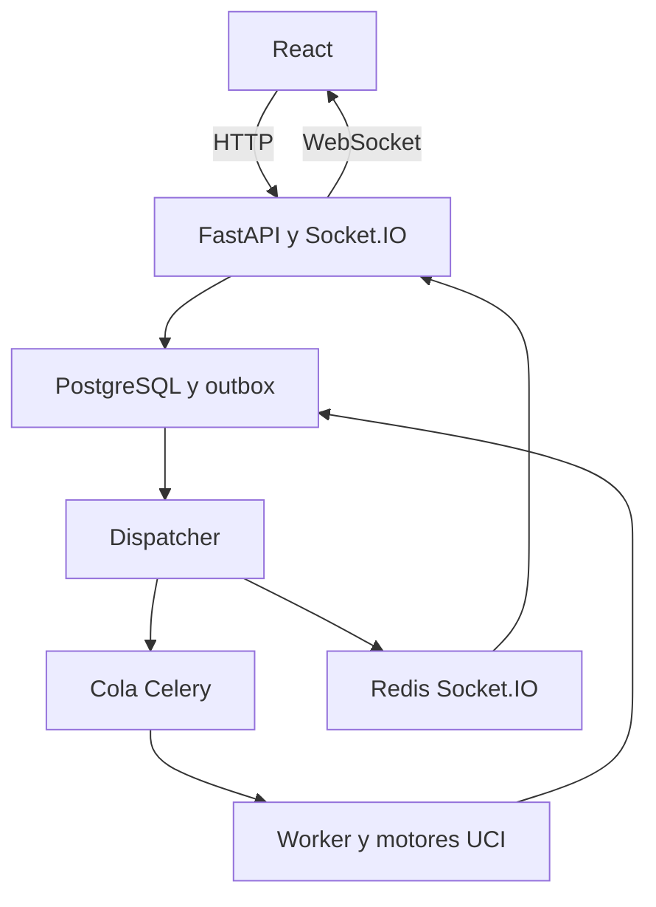

# ChessInsight — Análisis profundo en servidor (especificación unificada)

Estado: especificación implementable. Fecha: 2026-10-18.  
Documentos fusionados: `spec_analisis_profundo_asincrono.md` (prioridad en solapamientos) y `spec_análisis_profundo.md`.

## 0. Dos capacidades, una plataforma

| Capacidad | Alcance | Entrada principal | Perfiles |
|---|---|---|---|
| **A — Posición** | UNA posición desde el tablero; continuar navegando; notificación al terminar | FEN + historial UCI, candidata opcional | `general`, `sacrifice_attack` |
| **B — Partida completa** | Toda la partida; recalcular evaluaciones, errores e indicadores del filtro «Partidas para revisar» | Una o varias partidas seleccionadas | `server_deep_v1` (versionado) |

**Compartido:** Stockfish nativo en worker, trabajos persistentes, no bloquear HTTP, resultados reproducibles, análisis liviano (WASM/cliente) sigue como selección inicial — no se reemplaza ni se migran umbrales de error salvo adaptación técnica necesaria.

**Fuera de alcance global:** LLM y explicaciones estratégicas automáticas en MVP; Web Push/email; modificar motores; entrenar modelos; demostraciones matemáticas de victoria; etiquetar «brillante» automáticamente; generación automática de ejercicios.

**Instrucciones para implementación:** Antes de código, inspeccionar arquitectura real (auth, partidas/posiciones, UCI, jobs existentes — p. ej. module07 — workers, notificaciones). Reutilizar componentes. Nombres de archivos/clases aquí son candidatos. Feature flags y migraciones; no reemplazar el análisis liviano actual de un golpe.

---

## 1. Capacidad A — Análisis profundo asíncrono de posición

### 1.1 Objetivo

Solicitar análisis profundo de **una** posición desde el tablero, seguir usando la app y recibir aviso al finalizar. Incluir perfil orientado a sacrificios cuya compensación depende del ataque: si el defensor neutraliza amenazas y conserva ventaja material, puede ganar; si no resiste, pierde. Contemplar tablas y recuperación de material. Los motores aportan evaluaciones y variantes; no producen por sí solos explicación causal fiable.

### 1.2 Alcance A

Incluido: botón «Análisis profundo»; snapshot inmutable; cola persistente, worker separado, límites, cancelación y recuperación; Stockfish obligatorio; Lc0 opcional según servidor; PostgreSQL; eventos vía python-socketio + recuperación HTTP; notificación interna persistente, historial y variantes reproducibles.

Excluido: analizar automáticamente toda la partida (→ capacidad B); cambiar evaluaciones originales de la partida sin revisión explícita.

### 1.3 Experiencia de usuario (A)

1. Usuario selecciona posición y pulsa «Análisis profundo».
2. Panel: perfil, presupuesto permitido, contraste Lc0 si disponible. Por defecto: `general`, hasta 300 s de **ejecución**; espera en cola aparte.
3. En `sacrifice_attack` puede marcar candidata legal. UI distingue:
   - `decision`: evalúa desde la posición **anterior** al sacrificio.
   - `position_only`: posición actual (p. ej. tras aceptar); no concluye que el sacrificio original era la mejor decisión.
4. Al enviar: `job_id`, estado, snapshot. Tablero sigue disponible.
5. Fase y tiempo transcurrido; sin % artificial ni plazo garantizado de cola.
6. Cancelación disponible; cerrar pestaña no cancela.
7. Al finalizar: badge/toast + notificación «Análisis profundo finalizado»; abrir restaura snapshot exacto.
8. Panel resultado: evaluación, alternativas, mejor defensa, variantes, límites de evidencia. Si no se resolvió compensación, mostrarlo.

Perfil `general` no exige etiquetar ataque/sacrificio. El resultado no sobrescribe automáticamente anotación previa ni revisión del instructor.

### 1.4 Arquitectura candidata (prioritaria para A; referencia para B)

| Capa | Tecnología | Responsabilidad |
|---|---|---|
| UI | React + socket.io-client | HTTP, tablero, progreso, avisos |
| API | FastAPI + SQLAlchemy | Auth, contratos, persistencia |
| Tiempo real | python-socketio AsyncServer + ASGIApp | Conexiones autenticadas, rooms privadas |
| Base | PostgreSQL | Estado, snapshots, resultados, notificaciones, outbox |
| Cola | Celery + Redis broker | Entrega a workers |
| Worker CPU | Proceso/contenedor | Orquestación, Stockfish UCI |
| Worker GPU opc. | Cola/recurso separado | Lc0 si hay hardware |
| Eventos | Redis + Socket.IO RedisManager | Entre procesos/réplicas |
| Dispatcher | Proceso del módulo | Publicar outbox, reconciliar |

Separar namespaces del broker Celery y del manager Socket.IO. Pueden compartir Redis al inicio; no confundir Pub/Sub con cola durable.



FastAPI BackgroundTasks no ejecuta el análisis ni es el único despacho. No mantener motores en handlers Socket.IO. Celery result backend no reemplaza el modelo de dominio.

**Capacidad B:** Reutilizar esta pila cuando la inspección confirme que encaja; si ya existe cola/jobs de análisis de partidas (module07), **extender** en lugar de duplicar. B no exige WebSocket: polling HTTP o mecanismo existente es suficiente.

### 1.5 Consistencia y ciclo de vida (A)

Estados: `queued`, `running`, `cancel_requested`, `completed`, `cancelled`, `failed`.  
Fases: `baseline`, `candidate`, `defenses`, `deepening`, `crosscheck`, `finalizing`.

Transiciones: `queued` → `running` / `cancelled` / `failed`; `running` → `cancel_requested` / `completed` / `failed`; `cancel_requested` → `cancelled` / `failed`. Terminales no vuelven a `running`; nueva ejecución = nuevo job.

Job + outbox `job.dispatch_requested` en la misma transacción. Dispatcher publica tras commit; worker idempotente ante duplicados.

Reclamo atómico con `attempt_id`, `lease_expires_at`, heartbeat. Sin transacción abierta durante cálculo. Supervisor reencola leases vencidos; invalida intento anterior. Escrituras verifican token vigente.

Resultado terminal + notificación + outbox en una transacción; publicar tras commit. Si Redis cae, HTTP sigue consultable. Dedup eventos por `event_id` y `state_version`.

Cancelación idempotente; en `running`, `cancel_requested` y comprobación ≤1 s; UCI `stop`/`quit`; carrera cancelación/finalización con CAS.

### 1.6 Entrada ajedrecística y reproducibilidad (A)

Validar FEN, turno, legalidad, longitud. Ajedrez estándar en MVP.

`initial_fen` + movimientos UCI hasta `root_fen`. Solo FEN: conservar reloj de medio movimiento, `history_complete=false`. No reconstruir historial desde FEN. `candidate_move_uci` sobre raíz anterior al sacrificio en `decision`. `position_only` requiere `perspective_color` explícito.

Snapshots, parámetros y versiones inmutables. Sin caché compartida entre usuarios en MVP.

### 1.7 Perfiles y presupuesto global (A)

Límite **global** por job (no 300 s por rama). Reloj al reclamar; excluye cola; incluye arranque, búsquedas y persistencia. Reserva 10 s finalización.

```yaml
profile_version: 1
max_execution_seconds: 300
finalization_reserve_seconds: 10
max_attempts: 2
stockfish:
  threads: 2
  hash_mb: 256
  limit_strength: false
  show_wdl: true
  exploration_multipv: 4
  defense_multipv: 5
  max_critical_defenses: 3
  initial_search_seconds: 10
  candidate_search_seconds: 30
  defense_search_seconds: 20
  deepening_slice_seconds: 30
lc0:
  enabled: false
  optional_budget_seconds: 60
  unavailable_policy: skip_with_warning
resources:
  max_active_jobs_per_user: 1
  max_queued_jobs_per_user: 3
  worker_engine_slots: 1
```

Lc0 consume del total. Registrar `allocated_ms` / `consumed_ms` por etapa. Un proceso UCI por búsqueda a la vez.

### 1.8 Algoritmo (A)

**General:** MultiPV en raíz → profundizar candidatas → reanalizar críticas si cambia orden → Lc0 opcional → resultado con evidencia aunque no haya conclusión estratégica.

**Sacrificio:** Comparar candidata con mejor alternativa; `searchmoves` solo primer movimiento candidato; MultiPV en respuestas (aceptación inmediata o diferida); hasta 3 defensas críticas; profundizar ramas con MultiPV 1; evaluar hojas (amenazas, mate, material, perpetuo); presupuesto creciente donde cambie conclusión; Lc0 como evidencia pendiente si hay desacuerdo. MVP conservador: `unresolved` si no resuelve compensación.

**Evaluación:** Scores normalizados a `perspective_color`; mate separado de cp; WDL con origen, sin promediar motores. Veredictos `sacrifice_attack`: `supported_by_analysis`, `refuted_by_line`, `draw_or_material_recovery`, `unresolved`, `not_applicable`. Separar `technical_stability` y `compensation_resolution`. Comparar con mejor alternativa (dos afirmaciones pueden coexistir).

### 1.9 Modelo persistente (A)

| Entidad | Campos mínimos |
|---|---|
| deep_analysis_jobs | id, user_id, game_id/position_id opc., snapshot JSONB, profile, scope, effective_config, status, phase, state_version, lease/heartbeat, cancel, error_code, dedup |
| deep_analysis_runs | job_id, attempt_id, stage, FEN/history, engine, limits, score, WDL, PV, … |
| deep_analysis_results | job_id único, verdict, stability, compensation, evidence_run_ids, limitations, completion_reason |
| notifications | user_id, job_id, type, read_at |
| outbox_events | event_id, kind, state_version, published_at, retries |

`completion_reason`: stable, budget_exhausted, terminal_position, optional_engine_unavailable. Presupuesto agotado con evidencia parcial → `completed` + `unresolved` si aplica. Fallo Lc0 opcional no invalida Stockfish.

### 1.10 Contratos HTTP (A)

Autenticados, solo propietario.

| Método y ruta | Función |
|---|---|
| POST /api/deep-analysis/jobs | Crear; 202 |
| GET /api/deep-analysis/jobs/{id} | Estado y snapshot |
| GET /api/deep-analysis/jobs | Lista paginada |
| POST /api/deep-analysis/jobs/{id}/cancel | Cancelar |
| GET /api/deep-analysis/jobs/{id}/result | Resultado o 409 |
| GET /api/notifications | Avisos |
| POST /api/notifications/{id}/read | Leído |

`Idempotency-Key` UUID; fingerprint incluye propietario, historial, candidata, perfil, config — FEN sola no basta. 422 entrada inválida; 429 cupo. No aceptar user_id, rutas de binarios ni UCI arbitrario del cliente.

Ejemplo POST (`sacrifice_attack`, `decision`): ver payload en spec asíncrona original (schema_version, position, candidate_move_uci, perspective_color, budget_seconds, crosscheck_lc0).

### 1.11 Socket.IO (A)

Namespace `/analysis`, path `/socket.io`. Auth en handshake (JWT en `auth`). Room `user:{id}` server-side. Eventos: `analysis.queued`, `analysis.started`, `analysis.phase_changed`, `analysis.completed`, `analysis.cancelled`, `analysis.failed` — metadatos pequeños; resultado por HTTP. ≤1 evento transitorio/s por job. Reconnect: refrescar jobs/notificaciones; dedup por `state_version`. Fallback: polling HTTP ~10 s con backoff mientras haya jobs activos.

### 1.12 Fiabilidad y seguridad (A)

Cola dedicada, prefetch bajo, outbox/reconciliador, UCI con rutas servidor, timeouts, limpieza de hijos, métricas sin tokens. Retención configurable; resultados sobreviven reinicios.

### 1.13 Pruebas de aceptación (A)

Criterios 1–17 de la spec asíncrona (202 sin bloqueo, snapshot inmutable, permisos, idempotencia, leases, cancelación UCI, presupuesto global, normalización, candidata fuera de MultiPV, unresolved vs failed, Lc0 degradado, PV legales, fixtures ajedrecísticos). Adaptadores simulados + integración UCI acotada + E2E reconexión/cancelación.

### 1.14 Entrega por etapas (A)

1. Dominio, migración, feature flag, idempotencia.  
2. Cola/worker, leases, outbox, Stockfish presupuesto global.  
3. UI, HTTP, Socket.IO, notificaciones.  
4. Perfil sacrificio sin LLM.  
5. Lc0 opcional y calibración.

---

## 2. Capacidad B — Análisis profundo de partida completa

### 2.1 Objetivo

Usuario selecciona partida(s) y solicita análisis profundo en servidor. Revisar **toda** la partida, recalcular evaluaciones y errores, detectar episodios de pérdida/recuperación de ventaja, actualizar indicadores «Partidas para revisar», persistir resultados consultables desde el tablero. Trabajo incompleto o fallido **no** reemplaza análisis completo anterior.

Lc0 **no** en la primera entrega de B; interfaz de resultados por motor preparada para Lc0 después.

### 2.2 Flujo funcional (B)

1. Selección de una o varias partidas → «Analizar en servidor».  
2. Backend valida y crea trabajos persistentes.  
3. Worker ejecuta Stockfish nativo (un proceso exclusivo por trabajo activo).  
4. Frontend: progreso por fase (polling o mecanismo existente; WebSocket no obligatorio).  
5. Al finalizar: guardar resultados, recalcular indicadores pedagógicos.  
6. Tablero y filtros usan análisis profundo completo como fuente **preferida**; conservar procedencia del liviano.

### 2.3 Arquitectura lógica (B)

- API: validación, creación, consulta.  
- Worker: fuera del proceso HTTP.  
- Adaptador UCI, servicio de recorrido, clasificación (política existente), servicio pedagógico determinista, persistencia separada (trabajo / análisis / ply / candidatas críticas / indicadores).

No compartir una instancia Stockfish entre partidas simultáneas. Frontend no controla el proceso del motor.

### 2.4 Perfil `server_deep_v1` (B)

| Parámetro | Valor inicial |
|---|---|
| Motor | Stockfish nativo, versión fijada |
| Threads | 1 |
| Hash | 256 MB |
| Presupuesto por búsqueda | 2 s |
| MultiPV general | 1 |
| MultiPV posiciones críticas | Hasta 3 |
| Presupuesto extra por crítica | 5 s |
| Concurrencia | 1 trabajo |

Ajustables sin cambio de código. «Profundo» = perfil vs liviano; no profundidad fija como único criterio de fin. Registrar profundidad alcanzada. Limitar concurrencia por CPU/memoria/API.

### 2.5 Preparación de partida (B)

Validar PGN y legalidad; `SetUp`/FEN si el proyecto ya lo soporta; rechazar variantes no soportadas. Secuencia desde inicio real; historial al motor, no solo FEN sueltas. Identificar jugador analizado para indicadores personales; si falta, análisis numérico por color sin indicadores personales.

### 2.6 Evaluación por posición y jugada (B)

Por posición (salvo terminales resolubles por reglas): ply, eval cp/mate, perspectiva, mejor jugada y PV, depth/seldepth, nodos, tiempo, WDL, estado de búsqueda. Internamente perspectiva uniforme desde blancas; convertir al mostrar/calcular indicadores del jugador.

Por jugada: eval mejor continuación desde posición anterior vs posición tras jugada; normalizar; pérdida `loss_cp = max(0, best_before_cp - played_after_cp)` si aplica; clasificación vigente. Mejor jugada previa → pérdida 0 con variación registrada. Mate: política explícita compatible con clasificador existente, no fórmula cp.

**Verificación antes de mistake/blunder/cambio de ventaja:** reanalizar posición anterior con más presupuesto; `searchmoves` para jugada realizada; presupuestos equivalentes; actualizar clasificación.

### 2.7 Segunda fase: posiciones críticas (B)

Tras recorrido general, seleccionar posiciones anteriores a: mistakes/blunders provisionales, pérdidas de ventaja, recuperaciones, cambios superioridad/inferioridad. Deduplicar por posición.

En cada crítica: MultiPV hasta 3 candidatas; verificar jugada realizada aunque no esté en top; recalcular error y eventos. No comparar scores de candidatas con presupuestos distintos. Coherencia entre eval final de jugada y la usada para clasificar error.

### 2.8 Indicadores pedagógicos (B)

Reutilizar reglas «Partidas para revisar»: mistakes/blunders propios y del rival, superioridad/inferioridad sostenidas, ventaja desaprovechada, recuperación, error hacia posición perdedora sin recuperación, cambios de ventaja. Recalcular tras verificación. Guardar id análisis, versión de reglas, parámetros, plies por evento. No mezclar secuencias liviano + profundo.

### 2.9 Estados, persistencia y deduplicación (B)

Estados mínimos: `queued`, `running`, `completed`, `failed`, `cancelled`. Progreso por fase (recorrido general / verificación) y unidades procesadas; heartbeat; intentos; cancelación detiene motor.

Huella: posición inicial + secuencia legal, binario/NNUE, perfil efectivo, versión algoritmo. Identidad del jugador afecta indicadores, no repetición de motor. Trabajo equivalente activo → reutilizar; análisis completo equivalente → reutilizar salvo recálculo explícito. Publicar como preferido solo tras guardar todo.

Sin checkpoints: reiniciar partida completa al recuperar; no mezclar intentos con configs distintas.

### 2.10 API y frontend (B)

Adaptar rutas al backend existente: crear trabajos por lista de partidas, consultar estado, cancelar, consultar análisis de partida. Respuesta inmediata con ids y `reused` si aplica. Permisos por partida; perfiles autorizados solo desde servidor.

UI: acción bulk, estado por partida, progreso, cancelación, reintento, indicador fuente liviano/servidor, candidatas y eventos en tablero; motor, perfil y fecha en detalle.

### 2.11 Pruebas de aceptación (B)

1. API crea trabajo sin esperar análisis.  
2. Worker analiza posiciones válidas.  
3. Normalización de signos ambos colores.  
4. Mejor jugada sin pérdida artificial por variación entre búsquedas.  
5. Verificación desde posición anterior en errores graves.  
6. Jugada realizada verificada fuera de MultiPV.  
7. Mate no convertido a cp ficticios.  
8. Indicadores solo del nuevo análisis.  
9. Fallido no reemplaza completo.  
10. Dedup trabajo/análisis.  
11. Cancelación libera motor.  
12. Timeout → fallo consultable.  
13. Recuperación tras reinicio worker.  
14. Historial y FEN inicial.  
15. Filtros y tablero preferen profundo completo.

Unitarias deterministas + adaptador simulado; integración corta Stockfish real (estructura y signos, no cp exactos).

### 2.12 Entregable (B)

Perfil versionado, worker persistente, adaptador nativo, recorrido + críticas, persistencia/dedup, indicadores, API, listado/tablero, pruebas y configuración documentada.

---

## 3. Roadmap integrado sugerido

| Fase | Contenido |
|---|---|
| 1 | Infra compartida: jobs, leases, outbox (según inspección module07/Celery), migraciones, feature flags |
| 2 | **B** MVP partida completa (`server_deep_v1`) + indicadores + polling |
| 3 | **A** posición + Socket.IO + notificaciones + perfil `general` |
| 4 | **A** `sacrifice_attack` |
| 5 | Lc0 opcional en A; calibración; revisión instructor |

El orden puede invertirse si el producto prioriza sacrificios desde tablero antes que bulk de partidas.

---

## 4. Fuentes técnicas

Decisiones de producto anteriores son propuestas ChessInsight. Consultar documentación de la versión instalada:

- [python-socketio — servidor y ASGI](https://python-socketio.readthedocs.io/en/stable/server.html)  
- [Managers Redis](https://python-socketio.readthedocs.io/en/stable/api_manager.html)  
- [Celery — tareas e idempotencia](https://docs.celeryq.dev/en/stable/userguide/tasks.html)  
- [Stockfish UCI](https://github.com/official-stockfish/Stockfish/wiki/UCI-%26-Commands)  
- [Lc0 — flags](https://lczero.org/play/configuration/flags/)

---

## 5. Documentos reemplazados

Este archivo sustituye para planificación a:

- `spec_analisis_profundo_asincrono.md` — contenido técnico de A preservado aquí.  
- `spec_análisis_profundo.md` — contenido de B integrado sin duplicar arquitectura A.

Mantener los archivos originales solo como histórico hasta acordar borrado o redirección en el índice de docs.
